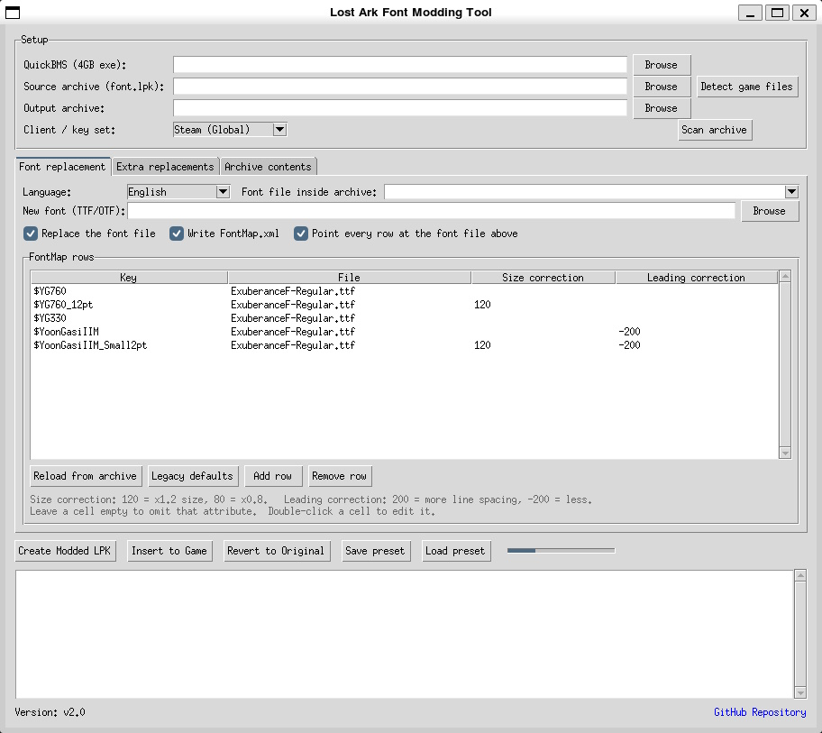
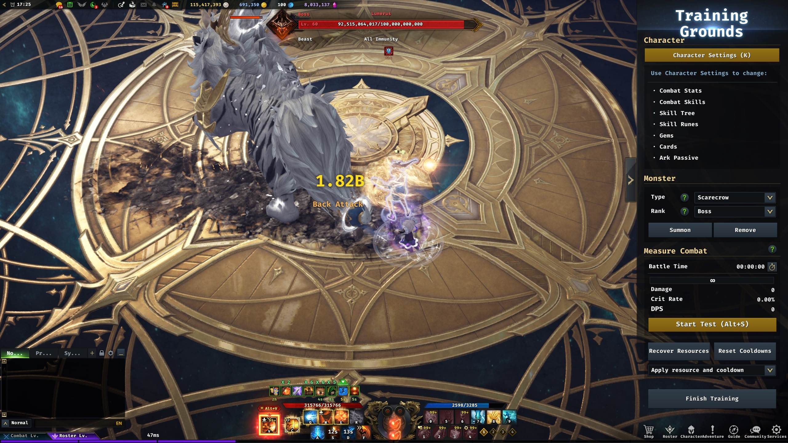

<div align="center">

# THIS PROJECT IS RETIRED

## A newer, actively maintained version is available now:

# [**LOAFONT-RS**](https://github.com/TanByv/loafont-rs)

### [Download the latest release](https://github.com/TanByv/loafont-rs/releases/latest)

</div>

> [!WARNING]
> This repository is no longer maintained and will not receive further updates.
> Please use [loafont-rs](https://github.com/TanByv/loafont-rs) instead. The
> documentation below is kept only as a reference for the legacy Python version.

# Lost Ark Font Modding Tool

A small GUI utility for patching the Lost Ark font.lpk archive and replacing the default game font with a custom TrueType font. It is intended for the English and Spanish builds and can create a modded archive, install it into the game, and restore the original backup when needed.

## Features

- Simple GUI for selecting the QuickBMS executable, source archive, and custom font
- Support for English and Spanish Lost Ark installs
- FontMap.xml generation with size and leading adjustments
- Automatic backup and restore of the original font.lpk
- Safe archive patching using QuickBMS

## Screenshots

### Main GUI



### In-game Showcase (FiraCode-Bold Font)



## Requirements

- Python 3.13 or newer for running from source
- QuickBMS executable for the archive patching step
- A Windows installation of Lost Ark with an EFGame folder containing font.lpk

## Windows executable

A standalone `LOA-Font-Tool.exe` is built with PyInstaller. Pushing a `v*` tag
runs the [release workflow](.github/workflows/build-release.yml), uploads the
executable as a workflow artifact, and attaches it to the GitHub release.

To build the executable locally on Windows:

```powershell
uv sync --group dev
uv run pyinstaller --noconfirm --clean --onefile --windowed --name LOA-Font-Tool --paths src run.py
```

The executable is written to `dist\LOA-Font-Tool.exe`.

## Running from source

1. Install Python 3.13 or newer from the official Python website.
2. Install uv if it is not already available:

   pip install uv

3. Open a terminal in the project root and install dependencies:

   uv sync

4. Launch the app:

   uv run loa-font-tool

5. You can also run it directly with Python if you prefer:

   python -m loa_font_tool.main

## QuickBMS setup

1. Download the QuickBMS package from the official release page.
2. Extract the 4GB-compatible executable, usually named quickbms_4gb_files.exe.
3. In the app, select the QuickBMS executable.
4. Select the original font.lpk file from the Lost Ark EFGame folder.
5. Choose your custom TTF font file.

## Usage

1. Run the tool.
2. Select the QuickBMS executable and the original font.lpk file.
3. Pick a custom TTF font and configure the size and leading corrections as needed.
4. Choose the game language if prompted.
5. Click Create Modded LPK to build the patched archive.
6. Click Insert to Game to back up the existing file and replace it in the game directory.
7. Use Revert to Original if you need to restore the backup.

## Notes

- The original font.lpk is backed up as font.lpk.bak before any changes are made.
- Other language versions may require different target indices or encryption keys.
- Contributions for Korean and Russian support are welcome.

## Troubleshooting

- QuickBMS not found: Make sure you select the correct quickbms_4gb_files.exe file.
- Game directory not detected: Manually browse to the Lost Ark EFGame folder when prompted.
- Permission errors: Run the program as administrator.

## Credits

- Original QuickBMS repacking script by [spiritovod & Brouznouf](https://zenhax.com/viewtopic.php@t=2969.html)
- [QuickBMS](https://aluigi.altervista.org/quickbms.htm) by Luigi Auriemma
